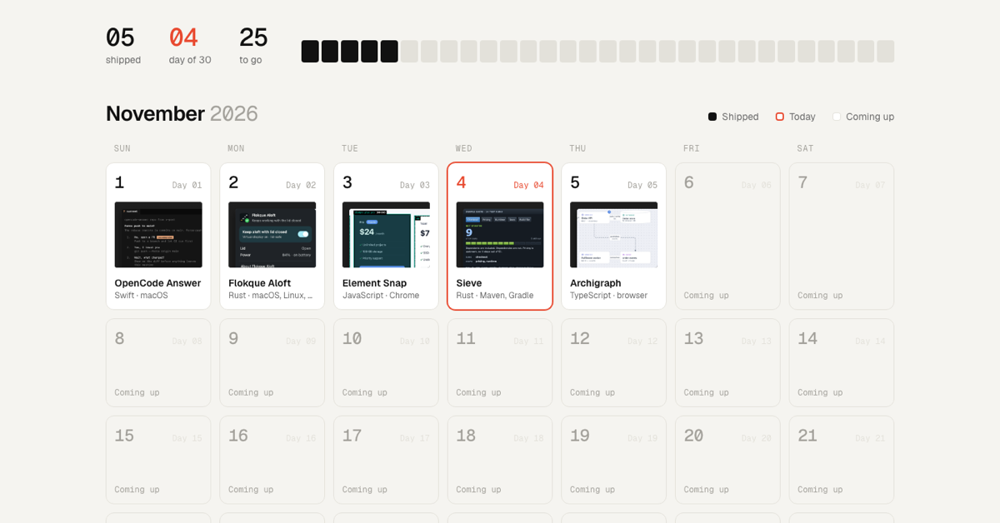

# 30 tools in 30 days

A tool building challenge: one new open source tool every day of November 2026, tracked on a calendar at **[preacherxp.github.io/30-days-of-tools](https://preacherxp.github.io/30-days-of-tools/)**.

## Shipped

| Day | Tool | What it does |
|---|---|---|
| 1 | [OpenCode Answer](https://github.com/preacherxp/opencode-answer) | A macOS menu bar app for answering OpenCode's questions without switching to the terminal |
| 2 | [Flokque Aloft](https://github.com/preacherxp/flokque-aloft) | Keeps your computer working with the lid closed |
| 3 | [Element Snap](https://github.com/preacherxp/element-snap) | A Chrome extension that saves any element on a web page as a pixel-exact image |
| 4 | [Sieve](https://github.com/preacherxp/sieve) | Runs only the JVM tests a change can affect |
| 5 | [Archigraph](https://github.com/preacherxp/archigraph) | An architecture diagram editor that ships as one self-contained HTML file |

## Adding a day

1. Add an entry to [`tools.js`](tools.js) and drop its image in `assets/`
2. Add a row to the table above
3. Push to `main`; GitHub Pages redeploys the site

The page is plain HTML with no build step. Open `index.html` in a browser to preview it.
